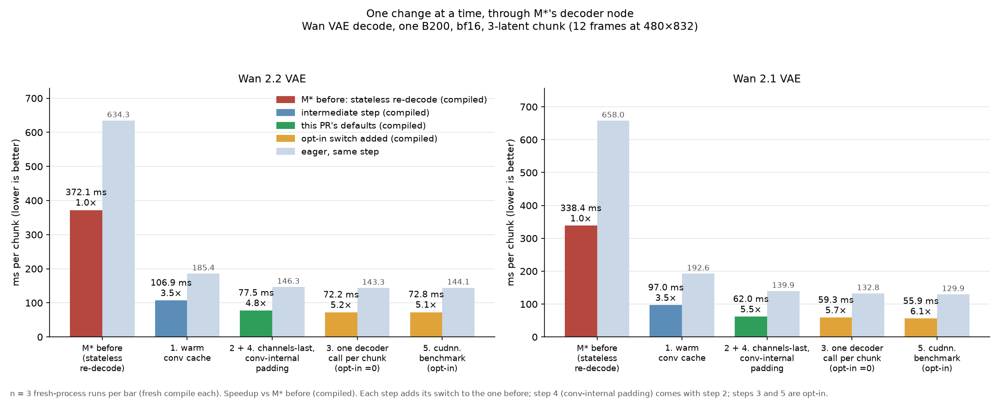
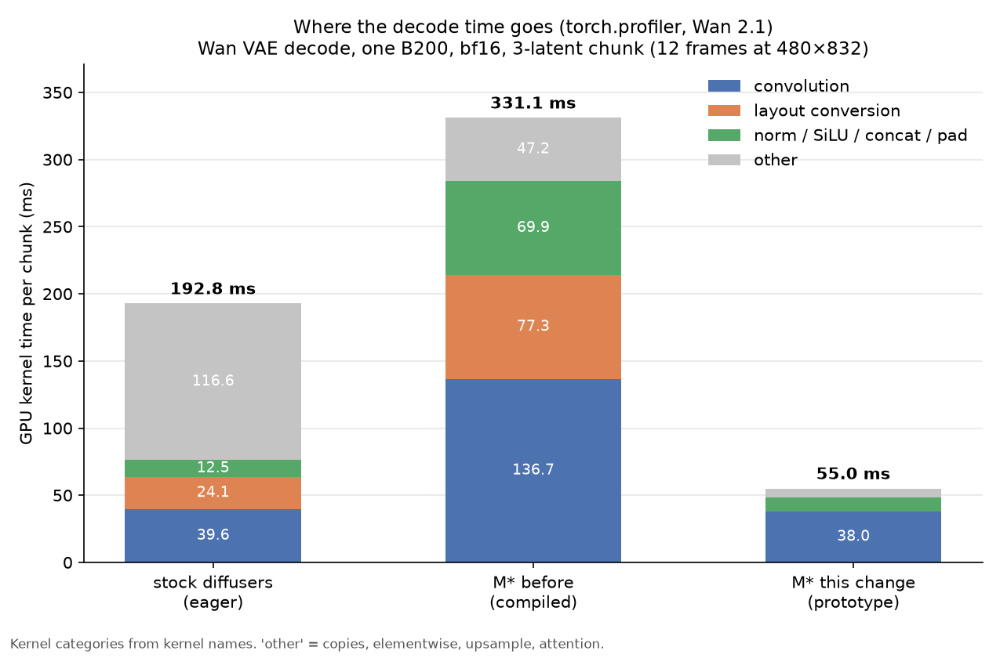
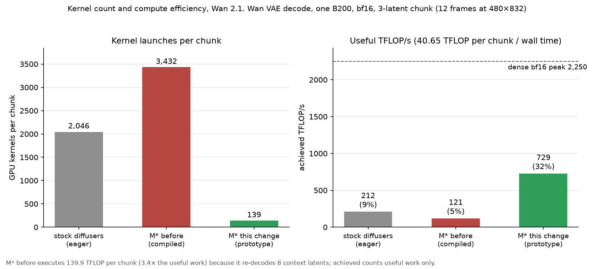
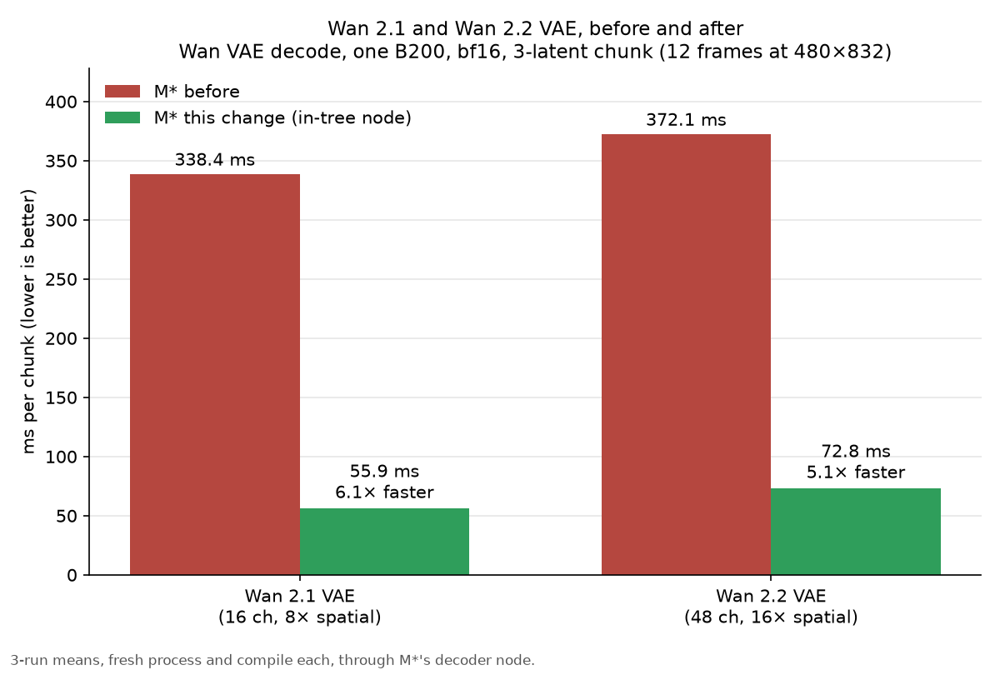
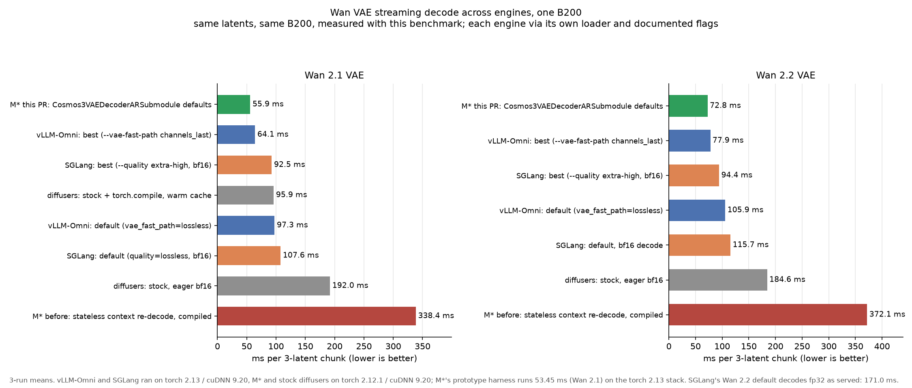
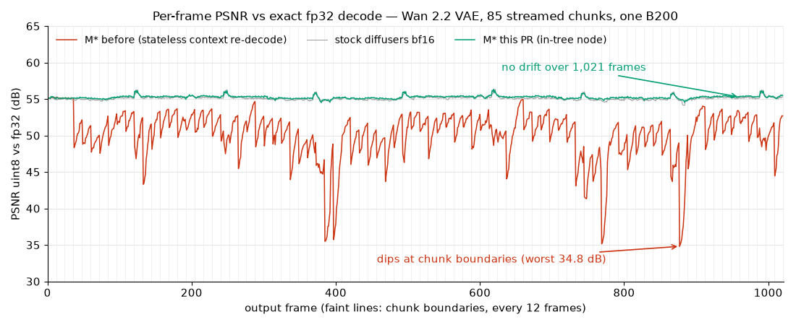

# Wan VAE streaming decode on one NVIDIA B200

Method: [`../../README.md`](../../README.md). Data: `variance.csv` (3-run means),
`runs.csv` (every single run), `intree.csv` (in-tree node, 3-run means),
`nodes.csv` (served windows), `profile.csv` (kernel breakdown and FLOPs),
`quality.csv`, `quality_frames.csv`, `coverage.csv`, `recon.csv` (output
equivalence), `ladder_wan21.csv` / `ladder_wan22.csv` (the change ladder through
M*'s node), `comparison.csv` (all engines; built by
`external/merge_comparison.py` from `external/*/`). Charts: `charts/`, from
`plot_results.py`.

| | |
|---|---|
| GPU | NVIDIA B200 180 GB, 1000 W power limit, driver 580.173.02 |
| Software | torch 2.12.1+cu132, CUDA 13.2, cuDNN 9.20.0, Triton 3.7.1, diffusers 0.39.0 |
| M* model code | ladder, variance, profiles: `upstream/main` 99f5108b (M* before) with the prototype harness; in-tree node, output equivalence: this branch (4b8b4789) |

Input: a 6.5 s 4K natural video clip (hands drawing on a tablet), cropped to
832×480 and ping-ponged to 1,021 frames, encoded to 256 latent frames (1 + 85
chunks) with each VAE's own encoder.

## 1. Per-change gains, in-tree

Each step turns on one more switch in M*'s `Cosmos3VAEDecoderARSubmodule`,
fed the normalized latents the DiT hands it (`run_ablation.sh ladder`). Each
row is 3 fresh-process runs, orders ABC / CBA / BCA, median ms per chunk;
compiled is the node's default, eager the same switches without compile.
Conv-internal padding (`ChannelsLastCausalConv3d`) has no switch of its own:
`vae_decode_channels_last` installs it, so step 2 includes it. Kernels per
chunk from one profiled run; TFLOP/s is useful work over wall time; the output
column compares the full 1,021-frame uint8 stream (md5, then share of values
that differ) with the step before, and step 1 with stock diffusers bf16 fed
the same input; PSNR is uint8 against the fp32 reference over the first 10
steady chunks.

**Wan 2.1 VAE**

n = 3 per row.

| mode | step | change | ms / chunk (3-run mean, spread) | vs previous | vs step 0 | decoder fps | kernels / chunk | TFLOP/s | peak GiB | uint8 output vs previous step | PSNR vs fp32 |
|---|---|---|---:|---:|---:|---:|---:|---:|---:|---|---:|
| compiled | 0 | M* before: stateless context re-decode (8 latents, empty cache) | 338.37 (0.4%) |  | 1.0× | 36 | 3,432 | 120 | 6.3 | — | 52.09 |
| compiled | 1 | + warm conv cache across chunks | 96.98 (1.3%) | 3.49× | 3.5× | 124 | 972 | 419 | 6.2 | 10.1% ≠ stock | 54.42 |
| compiled | 2 | + channels-last, conv-internal padding (steps 2 and 4) | 61.98 (2.3%) | 1.56× | 5.5× | 194 | 481 | 656 | 8.2 | 4.6% of values ≠ | 54.42 |
| compiled | 3 | + one decoder call per chunk | 59.26 (3.0%) | 1.05× | 5.7× | 202 | 149 | 686 | 19.0 | 4.7% of values ≠ | 54.42 |
| compiled | 5 | + `cudnn.benchmark` | **55.88** (3.9%) | 1.06× | **6.1×** | 215 | 149 | 727 | 19.0 | 3.3% of values ≠ | 54.42 |
| eager | 0 | M* before: stateless context re-decode (8 latents, empty cache) | 657.96 (0.0%) |  | 1.0× | 18 | 7,384 | 62 | 4.6 | — | 52.05 |
| eager | 1 | + warm conv cache across chunks | 192.59 (0.0%) | 3.42× | 3.4× | 62 | 2,055 | 211 | 4.5 | byte-identical to stock | 54.41 |
| eager | 2 | + channels-last, conv-internal padding (steps 2 and 4) | 139.85 (0.0%) | 1.38× | 4.7× | 86 | 1,558 | 291 | 4.0 | 5.5% of values ≠ | 54.41 |
| eager | 3 | + one decoder call per chunk | 132.80 (0.1%) | 1.05× | 5.0× | 90 | 495 | 306 | 8.0 | 4.7% of values ≠ | 54.41 |
| eager | 5 | + `cudnn.benchmark` | 129.89 (1.0%) | 1.02× | 5.1× | 92 | 495 | 313 | 8.0 | 4.1% of values ≠ | 54.41 |

**Wan 2.2 VAE**

n = 3 per row.

| mode | step | change | ms / chunk (3-run mean, spread) | vs previous | vs step 0 | decoder fps | kernels / chunk | TFLOP/s | peak GiB | uint8 output vs previous step | PSNR vs fp32 |
|---|---|---|---:|---:|---:|---:|---:|---:|---:|---|---:|
| compiled | 0 | M* before: stateless context re-decode (8 latents, empty cache) | 372.08 (0.5%) |  | 1.0× | 32 | 3,536 | 237 | 6.4 | — | 51.08 |
| compiled | 1 | + warm conv cache across chunks | 106.87 (1.1%) | 3.48× | 3.5× | 112 | 997 | 825 | 6.3 | 9.1% ≠ stock | 55.39 |
| compiled | 2 | + channels-last, conv-internal padding (steps 2 and 4) | 77.51 (2.7%) | 1.38× | 4.8× | 155 | 505 | 1138 | 7.4 | 3.6% of values ≠ | 55.40 |
| compiled | 3 | + one decoder call per chunk | 72.16 (2.7%) | 1.07× | 5.2× | 166 | 164 | 1222 | 15.9 | 3.8% of values ≠ | 55.40 |
| compiled | 5 | + `cudnn.benchmark` | **72.78** (3.4%) | 0.99× | **5.1×** | 165 | 165 | 1212 | 15.9 | 3.5% of values ≠ | 55.40 |
| eager | 0 | M* before: stateless context re-decode (8 latents, empty cache) | 634.30 (0.1%) |  | 1.0× | 19 | 7,853 | 139 | 5.7 | — | 51.13 |
| eager | 1 | + warm conv cache across chunks | 185.35 (0.0%) | 3.42× | 3.4× | 65 | 2,182 | 476 | 5.5 | byte-identical to stock | 55.39 |
| eager | 2 | + channels-last, conv-internal padding (steps 2 and 4) | 146.34 (0.4%) | 1.27× | 4.3× | 82 | 1,627 | 603 | 5.0 | 4.1% of values ≠ | 55.39 |
| eager | 3 | + one decoder call per chunk | 143.31 (0.6%) | 1.02× | 4.4× | 84 | 526 | 615 | 9.9 | 4.3% of values ≠ | 55.39 |
| eager | 5 | + `cudnn.benchmark` | 144.05 (0.7%) | 0.99× | 4.4× | 83 | 531 | 612 | 9.9 | 4.3% of values ≠ | 55.39 |

- **`cudnn.benchmark`** is worth 3.4 ms on Wan 2.1 here and nothing measurable on Wan 2.2 (within the spread). Its gain depends on GPU and resolution: on an H200 it saves 22.6 ms (18%) per Wan 2.1 chunk, because without it cuDNN picks an Ampere-generation kernel for 7 convs; at 1280×704 on the B200 it changes nothing. With it on, a second fresh process can produce slightly different frames (see Output equivalence).
- **The prototype harness.** The benchmark's own `StreamingDecoder` on raw latents applies the same changes. It agrees with the in-tree ladder at step 1 (95.90 ms) and at the last step (55.74 ms). In between, it splits channels-last (68.35 ms) from conv-internal padding with one call per chunk (59.11 ms), so the in-tree steps 2–3 land lower. Its full table is section 1b.
- **No number here comes from the prototype harness on Wan 2.2.** Its decoder compiles a stream's second call, and on torch 2.12.1 that call returns wrong frames for the first 1–2 chunks of Wan 2.2. The in-tree `DecoderStep` runs that call eagerly; its worst Wan 2.2 frame is 54.5 dB.

## 1b. Prototype harness ladder, Wan 2.1 VAE

The benchmark's own `StreamingDecoder` on raw latents, the changes applied one
at a time, with channels-last and conv-internal padding as separate rows.
ms per 3-latent chunk (12 frames at 480×832), bf16, each row adds one change to
the row above.

| # | change | variant | ms / chunk | vs M* before | decoder fps | peak GiB |
|---|---|---|---:|---:|---:|---:|
| | M* before: re-decodes 8 context latents from an empty cache every chunk (compiled) | `mstar_ar_ctx8` | 335.25 | 1.0× | 36 | 6.3 |
| 1 | keep the decoder's conv cache across chunks | `diffusers_bf16_compile` | 95.90 | 3.5× | 125 | 6.2 |
| 2 | channels-last weights and activations | `channels_last_compile` | 68.35 | 4.9× | 176 | 8.6 |
| 3 | one decoder call per chunk | `channels_last_one_call_compile` | 63.26 | 5.3× | 190 | 20.0 |
| 4 | H/W padding inside the conv, channels-last at every conv | `px_nopad` | 59.11\* | 5.7× | 203 | 19.0 |
| 5 | `cudnn.benchmark` | `px_nopad_bench` | **55.74** | **6.0×** | **215** | 19.0 |
| | all five, in-tree node (`Cosmos3VAEDecoderARSubmodule`) | `mstar_warm` | **56.30**† | **6.0×** | 213 | 19.0 |

\* single run; every other row is the mean of 3 fresh-process runs. The eager
M* streaming decode before this change is 656.85 ms per chunk.
† separate 3-run session (section 2b), in which M* before is 335.83 ms and the
prototype 55.85 ms; speedup against that session's M* before.

## 2. Run-to-run variance, Wan 2.1

Three independent runs, each variant a fresh process with fresh Inductor/Triton
caches, in the orders ABC / CBA / BCA. Median ms per chunk.

| variant | run 1 | run 2 | run 3 | mean | spread |
|---|---:|---:|---:|---:|---:|
| `diffusers_bf16` (stock, eager) | 191.96 | 192.03 | 191.96 | 191.98 | 0.07 (0.04%) |
| `diffusers_bf16_compile` | 95.85 | 95.93 | 95.92 | 95.90 | 0.08 (0.08%) |
| `mstar_ar_ctx8` (M* before, compiled) | 335.02 | 335.47 | 335.27 | 335.25 | 0.45 (0.13%) |
| `mstar_ar_ctx8_eager` | 656.84 | 656.85 | 656.85 | 656.85 | 0.01 (0.00%) |
| `channels_last_compile` | 68.30 | 68.39 | 68.36 | 68.35 | 0.09 (0.13%) |
| `channels_last_one_call_compile` | 63.29 | 63.17 | 63.33 | 63.26 | 0.16 (0.25%) |
| `px_base` (+ bf16 upsample) | 63.19 | 63.17 | 63.21 | 63.19 | 0.04 (0.06%) |
| `px_fp16` | 64.91 | 64.89 | 64.93 | 64.91 | 0.04 (0.06%) |
| `px_nopad_bench` (best) | 55.83 | 55.91 | 55.49 | 55.74 | 0.42 (0.75%) |

p90 is within 1–2 ms of the median for every variant. The single-run suite
(`runs.csv`, group `wan21`) agrees with these means to within 1 ms.

## 2b. The in-tree node

M*'s own `Cosmos3VAEDecoderARSubmodule` at this branch's defaults (warm cache,
channels-last, one decoder call per chunk, `cudnn.benchmark`), fed the
normalized latents the DiT hands it, against the prototype and M* before in the
same session (`intree.csv`): 3 fresh-process runs per variant, orders
ABC / CBA / BCA, median ms per chunk.

| VAE | variant | run 1 | run 2 | run 3 | mean | spread | peak GiB |
|---|---|---:|---:|---:|---:|---:|---:|
| Wan 2.1 | M* before (`mstar_ar_ctx8`) | 337.31 | 334.83 | 335.36 | 335.83 | 0.74% | 6.3 |
| Wan 2.1 | in-tree (`mstar_warm`) | 57.21 | 55.88 | 55.80 | **56.30** | 2.50% | 19.0 |
| Wan 2.1 | in-tree, eager (`mstar_warm_eager`) | 129.15 | 129.01 | 128.94 | 129.03 | 0.16% | 8.0 |
| Wan 2.1 | prototype (`px_nopad_bench`) | 56.12 | 55.56 | 55.87 | 55.85 | 1.00% | 19.0 |
| Wan 2.2 | M* before (`mstar_ar_ctx8`) | 368.96 | 369.24 | 368.34 | 368.85 | 0.24% | 6.4 |
| Wan 2.2 | in-tree (`mstar_warm`) | 74.17 | 74.21 | 72.90 | **73.76** | 1.78% | 16.0 |
| Wan 2.2 | in-tree, eager (`mstar_warm_eager`) | 142.32 | 142.78 | 143.06 | 142.72 | 0.52% | 9.9 |
| Wan 2.2 | prototype (`px_nopad_bench`) | 72.02 | 72.93 | 71.93 | 72.29 | 1.38% | 15.9 |

In-tree vs M* before: 6.0× (Wan 2.1) and 5.0× (Wan 2.2). In-tree vs the
prototype: +0.45 ms (0.8%) and +1.47 ms (2.0%). A kernel profile of both
(6 steady chunks each) shows the same GPU work: 149 vs 139 kernels per chunk
(Wan 2.1) and 164 vs 154 (Wan 2.2), the extra ones being the node's eager
de-normalization, `post_quant_conv`, clamp and uint8 copy; convolution
37.9 / 37.9 ms and 58.5 / 59.2 ms; no layout conversions; GPU kernel time 54.9
vs 55.1 ms and 70.3 vs 71.7 ms. The gap is host time between kernels (about
0.5–1 ms per window of eager ops and Python in the node) plus `cudnn.benchmark`
picking different algorithms in each fresh process.

`cudnn.benchmark` control, in-tree node, 3 runs each in one session: on 56.57 ms
(spread 2.3%), off 58.80 ms (spread 0.2%).

### Served windows and memory

`bench_decode_nodes.py`, M*'s node driven with the served window: 8 latents, 2
re-pinned, so 6 new latents per decoder call, 832×480, 30 timed windows
(`nodes.csv`).

| VAE | latents per decoder call | ms per window | ms per 12 frames | peak GiB | cache per stream |
|---|---|---:|---:|---:|---:|
| Wan 2.1 | all 6 (default) | 112.43 | 56.21 | 35.3 | 1.76 GiB |
| Wan 2.1 | 1 | 120.06 | 60.03 | 8.2 | 1.76 GiB |
| Wan 2.2 | all 6 (default) | 142.81 | 71.41 | 28.8 | 1.33 GiB |
| Wan 2.2 | 1 | 152.65 | 76.33 | 7.4 | 1.33 GiB |

One call per window costs 27 GiB (Wan 2.1) and 21 GiB (Wan 2.2) of peak
activation memory at served window size for 6% less decode time;
`windowed_decode_latents_per_call=1` keeps the peak at 7–8 GiB.

## 2c. Memory and the warm-stream cap

- **Per-stream cache:** 1.76 GiB (Wan 2.1) and 1.33 GiB (Wan 2.2) in bf16 at 832×480, one per live warm stream on the decoder copy serving it. It is outside any engine resource pool and grows linearly with live streams. `windowed_decode_max_warm_streams` caps it per copy, and `max_concurrent_requests` also bounds it.
- **Transient decode peak**, one decode at a time, set by `windowed_decode_latents_per_call`. The default stays at 0 (one call per window); the table shows `=1` next to it.

| `windowed_decode_latents_per_call` | 0 (default, one call per window) | 1 (one call per latent) |
|---|---|---|
| served window, 832×480, Wan 2.1 (6 new latents) | 56.21 ms per 12 frames, 35.3 GiB peak | 60.03 ms per 12 frames, 8.2 GiB peak |
| served window, 832×480, Wan 2.2 | 71.41 ms, 28.8 GiB | 76.33 ms, 7.4 GiB |
| 3-latent window, 1280×704, Wan 2.2 (samples) | 159.4 ms, 34.7 GiB | 162.2 ms, 15.5 GiB |
| output vs one `vae.decode` of the stream | within bf16 rounding | the same decoder calls (bit for bit eagerly, in fp32 or the default layout) |

At 832×480, one call per window is about 6% faster for +21–27 GiB of transient peak. At 1280×704 it saves 3 ms per window for +19 GiB, and the stream's first 3-latent window then runs eagerly as one call (409 vs 236 ms), so a 10-chunk clip takes longer in total (1.87 vs 1.74 s). The trade-off is in the config comment; the default is an open question below.

## 3. Where the time goes, Wan 2.1

`torch.profiler` over 6 steady chunks after warm-up; categories from kernel
names. One chunk is 40.65 TFLOP of useful work (40.47 in convs); minimum conv
traffic 26.3 GB, so ~1,550 FLOP/B, far above the B200 ridge point (2,250 TFLOP/s
÷ 8 TB/s ≈ 281 FLOP/B): compute-bound, roof 2,250 TFLOP/s dense bf16.

| ms per chunk | stock diffusers (eager) | M* before (compiled) | one call per chunk (`px_base`) | best (`px_nopad_bench`) |
|---|---:|---:|---:|---:|
| kernels per chunk | 2,046 | 3,432 | 170 | **139** |
| convolution | 39.6 | 136.7 | 40.7 | 38.0 |
| layout conversion | 24.1 | 77.3 | 0 | 0 |
| norm / SiLU (incl. fused pad, concat) | 8.4 | 29.9 | 9.3 | 9.2 |
| concat / pad | 4.0 | 40.1 | 5.1 | 1.1 |
| upsample | 3.9 | 28.9 | 1.7 | 3.6 |
| attention | 1.9 | 7.1 | 1.3 | 1.3 |
| copies | 62.5 | 3.8 | 3.3 | 0.7 |
| other elementwise | 48.3 | 7.1 | 0.7 | 1.2 |
| GPU kernel time / wall time | 192.8 / 192.0 | 331.1 / 335.3 | 62.2 / 63.2 | 55.0 / 55.7 |
| TFLOP executed per chunk | 40.65 | 139.85 | 40.65 | 40.65 |
| achieved TFLOP/s (useful work / wall) | 212 (9%) | 121 (5%) | 643 (29%) | **729 (32%)** |
| conv kernels alone, TFLOP/s | 1,021 | 1,019 | 995 | 1,066 (47%) |

The conv kernels run at about the same rate in every column. M* before loses its
time to re-decoding (3.4× the useful FLOPs) and to everything around the convs:
77 ms of layout conversions and 70 ms of norm/SiLU/concat/pad. With
`cudnn.benchmark` the large 3×3×3 convs move to CUTLASS weight-stationary fprop
kernels.

## 4. Wan 2.2 VAE

48 latent channels, 16× spatial, chunk `[1, 48, 3, 30, 52]` → 12 frames at
480×832; 88.18 TFLOP per chunk (minimum conv traffic 23.4 GB, ~3,770 FLOP/B).
Single runs, except the last row (3-run mean, section 2b).

| decoder | variant | ms / chunk | vs M* before | kernels / chunk | achieved TFLOP/s | peak GiB |
|---|---|---:|---:|---:|---:|---:|
| M* before (compiled) | `mstar_ar_ctx8` | 370.13 | 1.0× | 3,536 | 238 (11%) | 6.4 |
| stock diffusers, eager | `diffusers_bf16` | 184.57 | 2.0× | 2,173 | 478 (21%) | 5.5 |
| stock diffusers + compile | `diffusers_bf16_compile` | 105.18 | 3.5× | | | 6.3 |
| one call per chunk | `px_base` | 75.89 | 4.9× | 186 | 1,162 (52%) | 16.6 |
| best | `px_nopad_bench` | 72.99 | 5.1× | 154 | 1,208 (54%) | 15.9 |
| in-tree node | `mstar_warm` | **73.76** | **5.0×** | 164 | **1,195 (53%)** | 16.0 |

M*'s whole-clip Wan2.2 decoder node (`mstar_wan22_oneshot_81f`, eager, before
this change) costs 184.5 ms per 12 frames, the same as stock diffusers.

## 5. Accuracy

Reference: diffusers fp32 eager, TF32 off. Re-running it reproduces it
bit-exactly; with TF32 allowed the same decode runs 234 ms instead of 2,407 ms
and lands at 80.0 dB, so the flag does change the convs. PSNR over the first 10
steady chunks, float output, peak 1.

| decoder (Wan 2.1) | PSNR float dB | PSNR uint8 dB |
|---|---:|---:|
| stock diffusers bf16, eager | 53.73 | 54.91 |
| `diffusers_bf16_compile` (change 1) | 53.91 | 54.98 |
| `channels_last_compile` (change 2) | 53.90 | 54.98 |
| `channels_last_one_call_compile`, `px_nopad`, `px_nopad_bench` (changes 3–5) | 53.91 | 54.98 |
| M* before (8 re-decoded context latents) | — | 52.09 |
| fp16 prototype (`px_fp16`) | 74.03 | 61.83 |
| fp32 with TF32 allowed | 80.00 | 68.26 |

The stateless context re-decode (8 latents) approximates the whole-stream decode
(52.1 dB uint8); keeping the cache decodes the stream exactly as one decode of
the whole stream would (55.0 dB, like every bf16 row). On CPU in fp32 with real
Wan 2.1 weights (`check_equivalence.py`), the warm-cache stream equals
`vae.decode` of the whole stream exactly, and the in-tree path with channels-last
and one call per chunk stays within 3.6e-6 of it.

The M* node rows take the normalized latents the DiT hands the node and
de-normalize them in bf16 (as before this change); the other rows are fed the raw
latents. That input step alone costs the in-tree Wan 2.1 decode 0.4–0.5 dB
against fp32 (54.42 vs 54.98 dB uint8 here, 54.40 vs 54.84 dB over the whole
stream in section 8); on Wan 2.2 the in-tree node lands at 55.27 dB, above stock
(55.12 dB).

## 6. Things that did not help

All on top of compiled, channels-last, one call per chunk (`px_base`, 63.44 ms
in the same batch).

| change | variant | ms / chunk | note |
|---|---|---:|---|
| manual CUDA graph per chunk | `px_cg` | 63.38 | GPU time already matches wall time within ~1 ms at 140–170 kernels |
| `torch.compile(mode="reduce-overhead")` | `px_ro` | 65.17 | |
| `torch.compile(mode="max-autotune-no-cudagraphs")` | `px_maxat` | 62.49 | `cudnn.benchmark` alone: 62.43 |
| best + manual CUDA graph | `px_cg_nopad_bench` | 55.83 | same as without (55.75 in this batch) |
| fp16 instead of bf16 | `px_fp16` | 64.91 | +1.7 ms vs `px_base`; much higher PSNR (74.0 dB); not in this change |
| bf16 nearest upsample | `px_base` vs `channels_last_one_call_compile` | 63.19 vs 63.26 | Inductor already fuses it |

## 7. Comparison with vLLM-Omni and SGLang

Same latents, same fp32 reference, same stream protocol and timing (3-latent chunks, 10 warm-up + 75 timed chunks replayed twice, median ms per chunk), 3 fresh-process runs per row, one B200.

| engine | version | setting | Wan 2.1 ms | Wan 2.2 ms | kernels / chunk | TFLOP/s | uint8 vs stock bf16 |
|---|---|---|---:|---:|---:|---:|---|
| M* before | upstream main | stateless context re-decode, compiled | 338.37 | 372.08 | 3,432 / 3,536 | 120 / 237 | 30.0% ≠ / 30.4% ≠ |
| diffusers | 0.39.0 | stock, eager bf16 | 191.98 | 184.57 | 2,046 / 2,173 | 212 / 478 | identical / identical |
| diffusers | 0.39.0 | stock + torch.compile, warm cache | 95.90 | 105.18 | — / — | 424 / 838 | 10.2% ≠ / 9.9% ≠ |
| vLLM-Omni | f69b1f2b | default (vae_fast_path=lossless) | 97.32 | 105.92 | 999 / 1,078 | 418 / 833 | identical / identical |
| vLLM-Omni | f69b1f2b | best (--vae-fast-path channels_last) | 64.08 | 77.85 | 444 / 463 | 634 / 1,133 | 7.6% ≠ / 6.3% ≠ |
| vLLM-Omni | f69b1f2b | best + cudnn.benchmark | 62.60 | 77.72 | 423 / 499 | 649 / 1,135 | not hashed / not hashed |
| SGLang | v0.5.21 | default (quality=lossless, bf16) | 107.64 | — | 891 / — | 378 / — | 7.6% ≠ / — |
| SGLang | v0.5.21 | default as served (fp32 decode) | — | 170.97 | — / 863 | — / 516 | — / 14.0% ≠ |
| SGLang | v0.5.21 | default, bf16 decode | — | 115.72 | — / 937 | — / 762 | — / 6.3% ≠ |
| SGLang | v0.5.21 | best (--quality extra-high, bf16) | 92.50 | 94.36 | 567 / 604 | 439 / 935 | 5.8% ≠ / 4.4% ≠ |
| SGLang | v0.5.21 | --enable-torch-compile, bf16 | 102.16 | 110.96 | 843 / 874 | 398 / 795 | 7.7% ≠ / — |
| **M* this PR** | in-tree node | Cosmos3VAEDecoderARSubmodule defaults | **55.88** | **72.78** | 149 / 165 | 727 / 1,212 | 15.7% ≠ / 13.1% ≠ |

Kernels per chunk come from one profiled run; TFLOP/s is useful work (40.65 / 88.18 TFLOP per chunk) over wall time. The uint8 column compares each engine with stock diffusers bf16 run on that engine's own stack. M*'s rows also carry the node's bf16 input de-normalization.

**Output quality, same streams.** Every engine's full 1,021-frame stream was compared with M*'s stock diffusers bf16 stream and fp32 reference, using `quality.py`'s metrics.

| VAE | engine | setting | PSNR vs fp32 mean / worst | worst SSIM vs fp32 | values ≠ stock (≥ 1 / ≥ 2) | md5 = stock | seam |
|---|---|---|---|---:|---|---|---:|
| 2.1 | M* | before: stateless context re-decode | 51.76 / 46.68 | 0.9923 | 30.0% / 2.401% | no | -0.59 dB |
| 2.1 | M* | this PR, in-tree node | 54.40 / 53.98 | 0.9978 | 15.7% / 0.125% | no | +0.03 dB |
| 2.1 | diffusers | stock bf16, eager | 54.84 / 54.36 | 0.9979 | 0.0% / 0.000% | yes | +0.02 dB |
| 2.1 | vLLM-Omni | `vae_fast_path=lossless` (default) | 54.84 / 54.36 | 0.9979 | 0.0% / 0.000% | yes | +0.02 dB |
| 2.1 | vLLM-Omni | `--vae-fast-path channels_last` | 54.82 / 54.31 | 0.9979 | 7.6% / 0.003% | no | +0.02 dB |
| 2.1 | SGLang | default (`quality=lossless`, bf16) | 55.21 / 54.40 | 0.9980 | 14.6% / 0.002% (7.6%†) | no | +0.07 dB |
| 2.1 | SGLang | best (`--quality extra-high`, bf16) | 55.16 / 54.33 | 0.9980 | 13.4% / 0.001% (5.8%†) | no | +0.07 dB |
| 2.2 | M* | before: stateless context re-decode | 50.11 / 34.83 | 0.9724 | 30.4% / 4.038% | no | -2.30 dB |
| 2.2 | M* | this PR, in-tree node | 55.27 / 54.48 | 0.9981 | 13.1% / 0.076% | no | +0.08 dB |
| 2.2 | diffusers | stock bf16, eager | 55.12 / 54.15 | 0.9980 | 0.0% / 0.000% | yes | +0.08 dB |
| 2.2 | vLLM-Omni | `vae_fast_path=lossless` (default) | 55.12 / 54.15 | 0.9980 | 0.0% / 0.000% | yes | +0.08 dB |
| 2.2 | vLLM-Omni | `--vae-fast-path channels_last` | 55.02 / 54.34 | 0.9980 | 6.3% / 0.008% | no | +0.07 dB |
| 2.2 | SGLang | default as served (fp32 decode) | 69.27 / 68.28 | 0.9999 | 19.9% / 0.037% (14.0%†) | no | +0.13 dB |
| 2.2 | SGLang | default + `--vae-decode-precision bf16` | 56.58 / 55.56 | 0.9984 | 11.7% / 0.008% (6.3%†) | no | +0.13 dB |
| 2.2 | SGLang | best (`--quality extra-high`, bf16) | 56.65 / 55.38 | 0.9984 | 10.8% / 0.003% (4.4%†) | no | +0.15 dB |

† SGLang converts to uint8 from an fp32 [0, 1] tensor, while M* and stock diffusers round `x / 2 + 0.5` in bf16 first. The figure in parentheses compares SGLang with stock diffusers converted SGLang's way. Stock converted that way also scores SGLang's PSNR, so SGLang's higher PSNR comes from its uint8 conversion, not its decode.

- Every bf16 configuration lands at bf16-rounding quality: within 0.5 dB of stock against fp32 once the uint8 conversion is matched, worst-frame SSIM ≥ 0.9977, ≤ 0.13% of values off by two or more levels, no seam (≤ 0.15 dB) and no drift.
- vLLM-Omni's default is byte-identical to stock on both VAEs (same md5). M*'s in-tree node is 0.44 dB below stock on Wan 2.1, from the node's bf16 input de-normalization, and 0.15 dB above it on Wan 2.2.
- The stateless context re-decode is the only approximation in the table.

**How each engine was measured.** Each engine's own decoder ran through its own loader with its documented flags, driven by this benchmark's stream protocol:

- **vLLM-Omni:** `WanStreamingDecoder.decode_chunk`, the warm-cache decoder LingBot-World serves AR blocks with (one latent per decoder call), on the VAE built as vLLM-Omni's diffusion stage builds it (`DistributedAutoencoderKLWan`, then `install_wan_vae_fastpath`). It ran in the `vllm/vllm-omni` nightly image at f69b1f2b.
- **SGLang v0.5.21:** `DecodingStage.decode` with the decode function pointed at `AutoencoderKLWan.causal_decode`, SGLang's streaming decode (one latent per decoder call), on the VAE from SGLang's `VAELoader` under its registered pipeline configs.
- **Stack:** both ran on torch 2.13 / cuDNN 9.20. On that stack M*'s Wan 2.1 prototype harness runs 53.45 ms, against 55.74 ms on M*'s torch 2.12.1.

- **SGLang** (v0.5.21 includes sgl-project/sglang#34125). Its bf16 convs run as fast as M*'s: the same CUTLASS sm100 kernels, about 39 ms per Wan 2.1 chunk. The gap is outside the convs, about 53 ms per chunk against about 17 ms for M*:
  - the fused RMSNorm+SiLU, 22.0 ms;
  - the causal cat/pad kernel, 12.5 ms (M* pads inside the conv);
  - eager residual adds, 12.7 ms;
  - one decoder call per latent, at 567 vs 149 kernels per chunk.

  Its chunked frames are md5-identical to its whole-clip `DecodingStage` decode, and 92–96% byte-identical to stock bf16. Its Wan 2.2 serving default decodes in fp32 (171.0 ms).
- **vLLM-Omni.** Its default level keeps activations channels-first, so cuDNN transposes around every conv (22.9 ms of layout conversion per Wan 2.1 chunk). `channels_last` removes that, but still issues one decoder call per latent (444 vs 149 kernels per chunk). It has no compile option for the VAE: no Wan pipeline compiles it, and its Triton fast-path kernels switch themselves off under compile tracing.

Harnesses and commands: [`../../external/`](../../external/).

## 8. Output equivalence

`quality.py` (`run_ablation.sh quality`): every ladder step and the in-tree
node decode the whole stream (1,021 frames) once in a fresh process; every
frame is compared with stock diffusers bf16 (eager, same dtype) and with the
fp32 reference (TF32 off), on uint8 frames unless noted. Data: `quality.csv`,
`quality_frames.csv` (per frame), `coverage.csv`, `recon.csv`.

**Lossless vs within bf16 rounding.**

| tier | configuration | evidence |
|---|---|---|
| bit-exact | the warm conv cache alone (eager, default layout, one latent per decoder call, no `cudnn.benchmark`) | through M*'s node, byte-identical uint8 frames to one stock decode of the same input on both VAEs, for every window pattern tried, including the clip-start latent alone and ragged tails (table below); on CPU in fp32, bit for bit with `vae.decode` (`test_wan_vae_decode.py`, `check_equivalence.py`) |
| within bf16 rounding | `torch.compile`, channels-last, one call per chunk, conv-internal padding, `cudnn.benchmark`, and so the in-tree defaults | 9–16% of uint8 values differ from stock, ≤ 0.12% by two or more levels; PSNR vs fp32 within 0.45 dB of stock; worst-frame SSIM ≥ 0.9978; no drift, no seam at chunk boundaries (in-tree node on both VAEs, prototype on Wan 2.1; the harness's Wan 2.2 rows are discussed below the tables) |
| approximation | M* before: the stateless context re-decode (8 latents of context, empty cache) | 30% of values differ from the whole-stream decode, up to 207 levels; worst frame 34.8 dB (Wan 2.2), on a chunk boundary; boundary frames 0.6 / 2.3 dB below the rest |

No step is byte-identical to stock eager bf16 over the full stream: change 1
already compiles the decoder, and Inductor's fusions round differently. Each
later step changes another 0.2–5.4% of the values, without moving any aggregate
metric.

**Wan 2.1 VAE**, 1,021 frames:

| decoder | = stock | values ≠ stock (≥ 1 / ≥ 2 levels, max) | ≠ previous step | PSNR vs fp32 mean / worst | PSNR vs stock mean / worst | SSIM vs fp32 mean / worst | LPIPS vs fp32 / stock | flicker vs stock | seam dB | 2nd process |
|---|---|---|---:|---|---|---|---|---:|---:|---|
| M* before (re-decode 8 context latents) | no | 30.00% / 2.40%, 83 |  | 51.76 / 46.68 (c72 f1⟂) | 52.12 / 46.60 | 0.9966 / 0.9923 | 1.0e-03 / 9.8e-04 | 0.424 | -0.59 |  |
| 1. keep conv cache (+ compile) | no | 10.19% / 0.006%, 10 | 29.10% | 54.93 / 54.46 (c26 f4) | 58.05 / 57.28 | 0.9980 / 0.9978 | 2.3e-04 / 1.1e-04 | 0.180 | +0.00 |  |
| 2. + channels-last | no | 10.19% / 0.006%, 10 | 4.63% | 54.93 / 54.43 (c26 f4) | 58.05 / 57.27 | 0.9980 / 0.9978 | 2.3e-04 / 1.1e-04 | 0.180 | +0.00 |  |
| 3. + one call per chunk | no | 10.19% / 0.006%, 11 | 4.73% | 54.93 / 54.44 (c26 f4) | 58.05 / 57.29 | 0.9980 / 0.9978 | 2.3e-04 / 1.1e-04 | 0.180 | +0.00 |  |
| 4. + native conv padding | no | 10.19% / 0.006%, 11 | 0.24% | 54.93 / 54.44 (c26 f4) | 58.05 / 57.28 | 0.9980 / 0.9978 | 2.3e-04 / 1.1e-04 | 0.180 | +0.00 |  |
| 5. + `cudnn.benchmark` | no | 10.19% / 0.006%, 10 | 3.27% | 54.93 / 54.45 (c26 f4) | 58.05 / 57.27 | 0.9980 / 0.9978 | 2.3e-04 / 1.1e-04 | 0.180 | +0.00 | ≠, max float 0.00781 |
| in-tree node (`mstar_warm`) | no | 15.65% / 0.12%, 19 | 13.10% | 54.40 / 53.98 (c73 f12⟂) | 56.07 / 55.03 | 0.9979 / 0.9978 | 2.6e-04 / 1.8e-04 | 0.248 | +0.03 | ≠, max uint8 1 |
| in-tree, `cudnn.benchmark` off | no | 15.65% / 0.12%, 17 | 3.28% | 54.40 / 53.98 (c26 f4) | 56.07 / 55.04 | 0.9979 / 0.9978 | 2.6e-04 / 1.8e-04 | 0.248 | +0.03 | identical |
| stock diffusers bf16, eager | yes | 0 / 0, 0 |  | 54.84 / 54.36 (c26 f4) | — | 0.9980 / 0.9979 | 2.4e-04 / 0.0e+00 | 0.000 | +0.02 |  |

**Wan 2.2 VAE**, 1,021 frames:

| decoder | = stock | values ≠ stock (≥ 1 / ≥ 2 levels, max) | ≠ previous step | PSNR vs fp32 mean / worst | PSNR vs stock mean / worst | SSIM vs fp32 mean / worst | LPIPS vs fp32 / stock | flicker vs stock | seam dB | 2nd process |
|---|---|---|---:|---|---|---|---|---:|---:|---|
| M* before (re-decode 8 context latents) | no | 30.38% / 4.04%, 207 |  | 50.11 / 34.83 (c73 f1⟂) | 50.51 / 34.83 | 0.9955 / 0.9724 | 1.5e-03 / 1.4e-03 | 0.420 | -2.30 |  |
| 1. keep conv cache (+ compile) | no | 9.93% / 0.68%, 250 | 30.21% | 54.88 / 14.55 (c0 f4) | 58.17 / 14.54 | 0.9965 / 0.5533 | 2.0e-03 / 1.9e-03 | 0.259 | -0.08 |  |
| 2. + channels-last | no | 9.92% / 0.68%, 250 | 3.66% | 54.89 / 14.57 (c0 f4) | 58.17 / 14.56 | 0.9965 / 0.5541 | 2.0e-03 / 1.9e-03 | 0.259 | -0.08 |  |
| 3. + one call per chunk | no | 10.66% / 1.47%, 251 | 5.36% | 54.56 / 11.80 (c0 f5) | 57.82 / 11.80 | 0.9924 / 0.4231 | 6.3e-03 / 6.2e-03 | 0.367 | -0.14 |  |
| 4. + native conv padding | no | 10.66% / 1.46%, 251 | 1.30% | 54.56 / 12.35 (c0 f5) | 57.82 / 12.35 | 0.9926 / 0.4487 | 6.1e-03 / 6.0e-03 | 0.359 | -0.14 |  |
| 5. + `cudnn.benchmark` | no | 10.67% / 1.47%, 251 | 4.59% | 54.56 / 11.80 (c0 f5) | 57.82 / 11.80 | 0.9924 / 0.4231 | 6.3e-03 / 6.2e-03 | 0.367 | -0.14 | ≠, max float 0.0332 |
| in-tree node (`mstar_warm`) | no | 13.11% / 0.076%, 38 | 12.50% | 55.27 / 54.48 (c31 f8) | 56.86 / 54.76 | 0.9982 / 0.9981 | 2.0e-04 / 1.6e-04 | 0.209 | +0.08 | ≠, max uint8 4 |
| in-tree, `cudnn.benchmark` off | no | 13.11% / 0.077%, 34 | 3.53% | 55.27 / 54.54 (c31 f8) | 56.86 / 54.70 | 0.9982 / 0.9981 | 2.0e-04 / 1.6e-04 | 0.209 | +0.08 | identical |
| stock diffusers bf16, eager | yes | 0 / 0, 0 |  | 55.12 / 54.15 (c73 f8) | — | 0.9981 / 0.9980 | 2.0e-04 / 0.0e+00 | 0.000 | +0.08 |  |

cN fK = chunk N, frame K of 12; ⟂ = the first or last frame of a chunk.
"≠ previous step" is the share of uint8 values that differ from the row above
(the in-tree rows: from step 5, then from the in-tree node). Seam: mean PSNR of
each chunk's first frame minus its other frames. Flicker: mean
|Δ_t(decoder) − Δ_t(stock)| of the frame-to-frame differences, uint8 levels.
The PSNR trend over chunks is within ±0.05 dB per chunk for every row (no
drift).

- **Wan 2.2, prototype harness (torch 2.12.1).** Its decoder runs the stream's
  second call compiled; that call still sees diffusers' `"Rep"` markers in the
  cache and returns wrong frames, and the error decays out of the cache over frames
  1–10 (one latent per call) or 1–20 (one call per chunk), down to 11.8 dB. From
  chunk 2 on it matches the in-tree node (55.18 dB from chunk 10). The in-tree
  `DecoderStep` runs a stream's first two calls eagerly for exactly this reason;
  its worst Wan 2.2 frame is 54.5 dB. The timing benchmark's PSNR starts after
  10 warm-up chunks and is unaffected.
- **In-tree node input.** The M* node rows de-normalize the DiT's normalized
  latents in bf16 (unchanged by this PR), so they also differ from stock by that
  input step. Against stock fed the node's own input
  (`diffusers_bf16_node_input`), the in-tree node differs in 10.1% (Wan 2.1) and
  9.1% (Wan 2.2) of values, the same as the prototype against stock.
- **Determinism.** With `cudnn.benchmark` on, a second fresh process picks other
  conv algorithms and its frames differ (up to 1 uint8 level on Wan 2.1, 4 on
  Wan 2.2; 0.008 / 0.033 in float for the prototype). With it off, the in-tree
  node's second process is byte-identical on both VAEs. Turning it off costs
  2.2 ms per chunk (section 2b).

**Window coverage** (`quality.py coverage`): M*'s node over irregular windows
of the first 15 latents against one stock bf16 decode of the same stream, fed
the node's own VAE input.

| VAE | configuration | windows (latents) | byte-identical to stock | values ≠ | max | PSNR vs stock |
|---|---|---|---|---:|---:|---:|
| Wan 2.1 | warm cache only | 1+3+3+3+3+2 | yes | 0 | 0 | inf |
| Wan 2.1 | warm cache only | 1+2+5+4+3 | yes | 0 | 0 | inf |
| Wan 2.1 | warm cache only | 8+6+1 | yes | 0 | 0 | inf |
| Wan 2.1 | warm cache only | 1 | yes | 0 | 0 | inf |
| Wan 2.1 | this change's defaults | 1+3+3+3+3+2 | no | 6,341,418 | 3 | 58.44 |
| Wan 2.1 | this change's defaults | 1+2+5+4+3 | no | 6,565,789 | 3 | 58.29 |
| Wan 2.1 | this change's defaults | 8+6+1 | no | 5,423,820 | 3 | 59.12 |
| Wan 2.1 | this change's defaults | 1 | no | 70,021 | 2 | 60.46 |
| Wan 2.2 | warm cache only | 1+3+3+3+3+2 | yes | 0 | 0 | inf |
| Wan 2.2 | warm cache only | 1+2+5+4+3 | yes | 0 | 0 | inf |
| Wan 2.2 | warm cache only | 8+6+1 | yes | 0 | 0 | inf |
| Wan 2.2 | warm cache only | 1 | yes | 0 | 0 | inf |
| Wan 2.2 | this change's defaults | 1+3+3+3+3+2 | no | 5,399,225 | 4 | 59.13 |
| Wan 2.2 | this change's defaults | 1+2+5+4+3 | no | 5,625,984 | 4 | 58.95 |
| Wan 2.2 | this change's defaults | 8+6+1 | no | 4,492,752 | 4 | 59.93 |
| Wan 2.2 | this change's defaults | 1 | no | 56,107 | 3 | 61.41 |

**Encode + decode vs the source clip** (`recon.csv`): uint8 PSNR against the
clip itself over its first encoded piece (frames 0–120; the encoder runs in
121-frame pieces, so later frames do not line up one to one).

| decoder | Wan 2.1 | Wan 2.2 |
|---|---:|---:|
| stock diffusers bf16, eager | 43.43 dB | 44.45 dB |
| in-tree node (`mstar_warm`) | 43.33 dB | 44.43 dB |
| prototype harness, all five (`px_nopad_bench`) | 43.40 dB | 41.05 dB |
| M* before (re-decode 8 context latents) | 43.21 dB | 44.11 dB |

The prototype's Wan 2.2 figure includes its wrong first frames.

**torch 2.13** (not the stack measured here): Inductor's comprehensive stride
padding miscompiles the whole-decoder Wan 2.2 graph that torch 2.13 traces (a
cloned residual-shortcut buffer is read with padded channels-first strides
after being written channels-last), so compiled Wan 2.2 decodes (in-tree, the
prototype, and main's stateless compile) give wrong frames there. Compiling the
VAE decode with `options={"comprehensive_padding": False}` avoids it.
