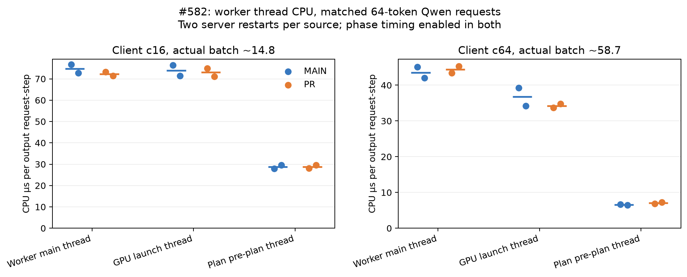
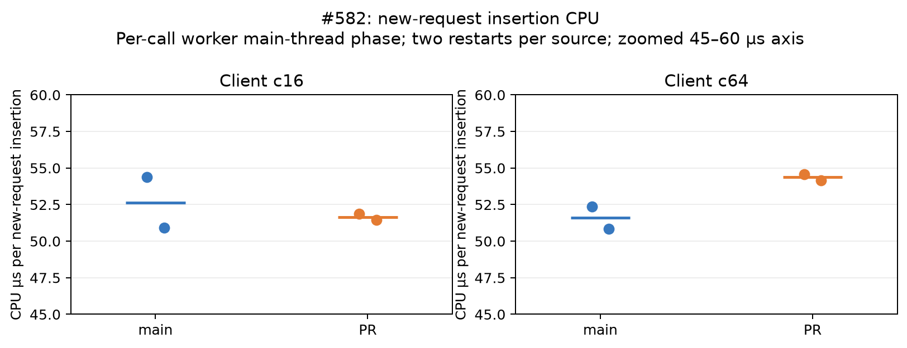

# M* #582 worker CPU profile

Measured on 2026-11-16 UTC with one H200 VM, pinned [Qwen3.5-0.8B checkpoint revision `2fc06364715b967f1860aea9cf38778875588b17`](https://huggingface.co/Qwen/Qwen3.5-0.8B/tree/2fc06364715b967f1860aea9cf38778875588b17) (safetensors SHA-256 `04b1c301231dd422b8860db31311ab2721511346a32cb1e079c4c4e5f1fe4696`). Main was `2c8ffde8f7fd321c29aad3d1aad3e8cc8e8dc175`; the PR implementation was `258b81371bc4626797177a5c93a14dad23405961`. Both used the Python frontend, Rust graph and SHM transport, the same `qwen.yaml` (SHA-256 `2996ac0f7465790f6b3055ed2649ba32f5d3ade3d3dc24a0f76f4041224235d6`), and `MSTAR_PHASE_TIMING=100`.

The balanced order was main1, PR1, PR2, main2, with a fresh server boot for each arm. Each arm ran 2,560 requests at client concurrency 16 and 5,120 at concurrency 64. Every request generated exactly 64 tokens; all 30,720 requests completed without client errors. The eight fixed prompts are in [prompts.txt](prompts.txt). Each cell had two warmup waves. The source and wheel SHA, exact launch command, config hash, checkpoint revision, client window timestamps, raw per-request client metrics, and worker logs are in [raw](raw/).

For each client window, [analyze.py](analyze.py) drops the first three phase flushes, groups records within 15% of the first observed batch size, and selects the longest steady segment. Main-thread `iter_total.cpu` is thread CPU time per output request-step. `worker.msg.new_request.runtime_add.cpu` is thread CPU time per new request. GPU-launch and plan-thread phases are separate; they are not added to main-thread time. Wait phases and nested subphases are not counted as extra CPU work.

| Client concurrency | Actual worker batch | Phase | Main, mean of 2 boots | PR, mean of 2 boots | PR change |
| --- | --- | --- | ---: | ---: | ---: |
| 16 | 14.83 in all arms | Main-thread CPU per output step | 74.76 µs (72.78, 76.75) | 72.32 µs (71.45, 73.18) | -3.27% |
| 64 | 58.58–58.77 | Main-thread CPU per output step | 43.56 µs (42.05, 45.07) | 44.37 µs (43.42, 45.31) | +1.85% |
| 16 | 14.83 in all arms | New-request insertion CPU per call | 52.65 µs (50.91, 54.39) | 51.66 µs (51.45, 51.86) | -1.88% |
| 64 | 58.58–58.77 | New-request insertion CPU per call | 51.59 µs (50.83, 52.36) | 54.37 µs (54.15, 54.59) | +5.37% |

The parenthesized values are the two observed boot means, not a statistical confidence interval. The c64 main-thread ranges overlap. The c64 new-request phase is 2.77 µs higher per call in this run. These two-boot measurements do not establish a general performance bound. Instrumentation was enabled for both arms, so compare these profiled runs to each other, not to an unprofiled run. The PR source above was the measured implementation; later test/doc commits were not GPU-measured here.

The bundled [phase parser](phases.py) is identical in both measured sources (SHA-256 `0f26f72f7e6294acd18cfe3ea0c18ed87453c7cc7331f5d53db25d379a37b42f`). The raw [summary.json](summary.json) contains every arm's selected segment, actual batch range, record count, request-step count, and phase values. Run `PYTHONPATH=<matplotlib-site> python3 analyze.py` to regenerate the summary and plots. The [run-arm.sh](run-arm.sh) and [bench.py](bench.py) show the client command; each arm's `metadata.json` records the server command.
