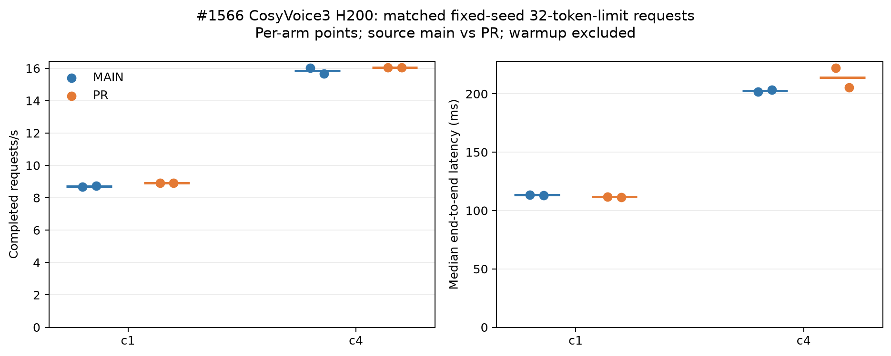

# CosyVoice3 RAS served check for #1566

This is a bounded H200 comparison of upstream main `2c8ffde8f7fd321c29aad3d1aad3e8cc8e8dc175` and PR head `e6701a1c75866f3331a9b8f39149bc89fcda5eb9`, run on 2026-11-16. The order was main1, PR1, PR2, main2. The VM was stopped after the run.

## Setup

- One NVIDIA H200, driver 580.173.02, CUDA 13.2, PyTorch 2.12.1+cu132. Python frontend, SHM transport, Rust graph bridge, `MSTAR_COMPILE_LEVEL=0`, `MSTAR_RUST_GRAPH=1`, `MSTAR_RUST_ZMQ=1`, default graph capture. The same [config](config.yaml) and Rust wheel were used for every arm.
- Official `FunAudioLLM/Fun-CosyVoice3-0.5B-2512` checkpoint at revision `29e01c4e8d000f4bcd70751be16fa94bf3d85a18`; cached files were SHA256-verified against their pinned download records. `llm.pt`: `69f43bd545131c30e98947fb360ea8b4dc9916d8e83dded7757c7ea4f5a24970`; `flow.pt`: `a6fab32a7825e5b0bc855ddd948f8db9370b0a786fbc249caa4595e95b608e4b`; `hift.pt`: `b279d7641eb97ae55b3b540cfba4f953c26492a2df758328a89a4d007ab87a65`. Speech-tokenizer ONNX etag: `23236a74175dbdda47afc66dbadd5bcb41303c467a57c261cb8539ad9db9208d`; CAMPPlus etag: `a6ac6a63997761ae2997373e2ee1c47040854b4b759ea41ec48e4e42df0f4d73`.
- Main source archive SHA256 `361e016bd30f7f0f88adbd0562bc55b52025ceb1063feeeb2915de4d772fb1a3`; PR source archive SHA256 `e3be1598256ec9cc978c89050574be8432c7a9c1a848e52a65f9a8cbf320ad0a`; common Rust wheel SHA256 `98afa004a36dcd11c72ccb0b221117dea2049be814303951ab3844d7bd45a499`.
- The [client](served_client.py) used fixed prompts, seeds, the official zero-shot reference WAV (SHA256 `c7b31d6dbe7cc6a716dded00550db5b50940bf209e424e4ad207b12e657c8ff6`), `max_new_tokens=32` and `ignore_eos=true`. The limit does not prove each response generated exactly 32 tokens. Each arm served three fixed parity prompts, 160 c1 requests and 256 c4 requests. Two warmup waves at each concurrency are excluded from throughput and latency. The client workload is closed loop; no separate arrival process was measured.

## Results

| Measure | main, two boots | PR, two boots |
| --- | ---: | ---: |
| c1 completed requests/s | 8.703 | 8.918 |
| c4 completed requests/s | 15.842 | 16.051 |
| c1 p50 end-to-end latency | 113.2 ms | 111.6 ms |
| c4 p50 end-to-end latency | 202.5 ms | 213.9 ms |

The 3 fixed parity samples and all 160 c1 PCM outputs matched bit for bit across all four arms. At c4, PCM hashes varied even between two boots of the **same** source: main1/main2 matched 167/256 and PR1/PR2 matched 200/256. Main1/PR1 matched 186/256. Audio sample counts matched in all 256 main1/main2 cases and 255/256 PR1/PR2 cases. This evidence does not isolate a RAS-caused c4 PCM difference; batch scheduling can change output. All responses contained nonempty PCM. The two boots per source are too few for a statistical non-regression claim. The c4 median latencies were 201.7/203.3 ms on main1/main2 and 222.2/205.6 ms on PR1/PR2.

The [summary](summary.json) gives each arm's throughput, audio output per second, p50/p95 latency, client CPU use and paired PCM counts. Each `arms/<name>/result.json` holds every request's latency, seed, PCM hash, sample count and RMS, plus measured wall time. `arms/<name>/server.cmd` is the exact server command; `server.log.gz` preserves startup and graph-capture evidence. Three PCM samples per arm are included. [Analyzer](analyze_served.py) regenerates the chart from raw JSON. [GPU check](gpu_check_result.json) and its [script](gpu_check.py) cover seeded eager sampling, real CUDA graph replay across changing padded batches, and the RAS threshold case on the same PR head. The synthetic GPU check does not establish real-checkpoint quality.

## Limits

This is one H200 and one released checkpoint with short text and a 32-token generation limit. We did not run a speech-quality listening study, longer generations, multi-GPU serving, or direct comparison to the upstream CosyVoice reference. The RAS implementation's quality impact remains to be assessed separately. These measurements should be read with the raw per-boot values, not as a guaranteed speedup.
