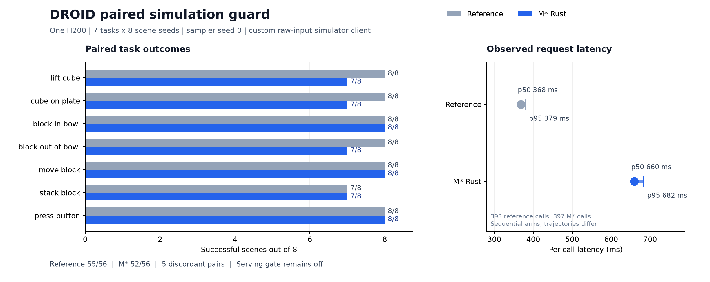

# DROID paired 56 guard: independent audit

[Paired report](paired-56-report.json) | [reference episodes](reference/suite/episodes.jsonl) | [M* episodes](mstar/suite/episodes.jsonl) | [independent audit](independent-audit.json)

The independent audit passed on the saved 112 per-episode JSON files and matching JSONL records.
One H200 ran the reference and M* Rust arms sequentially using the same seven tasks, eight scene seeds per task, and sampler seed 0.
The simulator client sent raw 288x512 observations and did not execute the advertised stock Positronic local_stack; this is a paired simulator result, not a stock-client interoperability result.
Both arms had zero restarts and bad-view ticks; all first calls had 21 action rows and later calls 24.

| Task | Reference | M* |
|---|---:|---:|
| `lift_cube` | 8/8 | 7/8 |
| `cube_on_plate` | 8/8 | 7/8 |
| `block_in_bowl` | 8/8 | 8/8 |
| `block_out_of_bowl` | 8/8 | 7/8 |
| `move_block` | 8/8 | 8/8 |
| `stack_block` | 7/8 | 7/8 |
| `press_button` | 8/8 | 8/8 |
| **Total** | **55/56** | **52/56** |

Five discordant pairs: four reference-only successes and one M*-only success.

| Arm | Calls | P50 ms | P95 ms |
|---|---:|---:|---:|
| reference | 393 | 368.2 | 379.4 |
| mstar | 397 | 659.5 | 682.4 |

M*/reference pooled call p50 ratio: 1.791x.
These per-call latency samples come from different closed-loop trajectories and sequential arms, so they are descriptive, not a controlled A/B throughput result.
Reference attention requested/effective Triton and M* Flex TRITON were checked; the M* ragged kernel was not observed.
The model manifest lists all hashed local checkpoint artifacts, but the stopped VM prevents an independent rehash of their bytes from this host.
The checker and this audit confirm recorded source archive/YAML hashes, reference worktree status/diff, paired prompts/seeds and output schedules.
Source-matched Rust binary verification is recorded by the operator log and source-files.sha256; this host did not independently rehash the remote binary.
The serving gate remains off.
