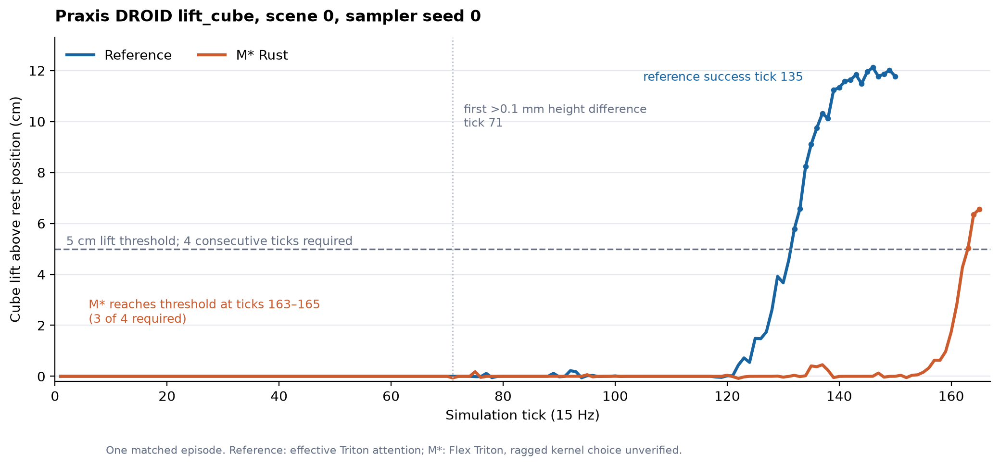

# Paired Praxis DROID simulation on one H200

The reference succeeded on all seven task/scene pairs. M\* succeeded on six; `lift_cube` scene 0 was the miss. These are seven individual episodes, one scene per task, so the 7/7 and 6/7 counts are a regression check rather than estimated success rates. [The outcome chart](seven_task_guard.png) shows the actual pairs selected by the earlier `--shard 0/8` run.

Both `lift_cube` traces began with identical observation fingerprints, task prompt and sampling seed. The first composed pose commands differed by 1.36% relative L2 (maximum absolute element difference 0.02382); the maximum gripper difference was 0.00723. Cube heights first differed by more than 0.1 mm at tick 71. The reference met the task's four-tick hold condition at tick 135 and finished at tick 150. M\* crossed the 5 cm lift threshold only at ticks 163–165, three of the four required ticks, and stopped at tick 165.

The runs used the same DROID BF16 checkpoint, sampler seed 0, per-task prompt and scene seed for each pair. The reference was pinned to `68f4d7a254b4bf41951d2e97f44b07f6cac2bf69`; M\* Rust served code from `5902054c0f9fa057a80ae5a7e15e67f19d4bcde2` with only its disposable serving gate and local weight paths changed. The reference's 20 attention modules were checked to use Triton. M\*'s Flex backend was checked as TRITON, but its ragged attention kernel choice was not observed. This comparison shows a reproducible closed-loop difference, not the cause of the numerical gap.

The GPU VM was independently verified STOPPED after about 0.26 GPU-hours. The committed `_SERVABLE` gate stayed off.

## Files

- `lift_cube_scene0.png`/`.svg` and `seven_task_guard.png`/`.svg`: figures from the exact paired run. `plot.py` regenerates them with Matplotlib from the included `raw/` data.
- `raw/*-lift-original-scene0/`: per-tick JSONL traces and simulator NPZ arrays for scene 0.
- `raw/{reference,mstar}-original/`: exact seven episode JSON records and summaries.
- `raw/analysis.json`: checked comparison of observation hashes, first commands, lift threshold and task outcomes.
- `raw/backend-gates.txt`: extracted backend assertions and SHA-256 hashes of the full logs. Full weight-loading and server logs are omitted.
- `raw/source-config.sha256`, `raw/model-artifacts.sha256`, `raw/runner-source.sha256` and `raw/operator-source.sha256`: hashes of the source, model artifacts and diagnostic scripts. Model paths are relabeled by artifact type; no weight files are included.
- `raw/reference-working-tree.actual.diff`, `.status`, `raw/operator/` and the resolved YAML files: the reference's checked edits, disposable run scripts and exact served configs.
- `PROVENANCE.txt`: hashes of the files used by `plot.py` and the interpretation limits.

Regenerate the figures from this directory with `uv run --no-project --with matplotlib python plot.py`. The PNGs were regenerated from the included raw data and matched the originals byte for byte.
