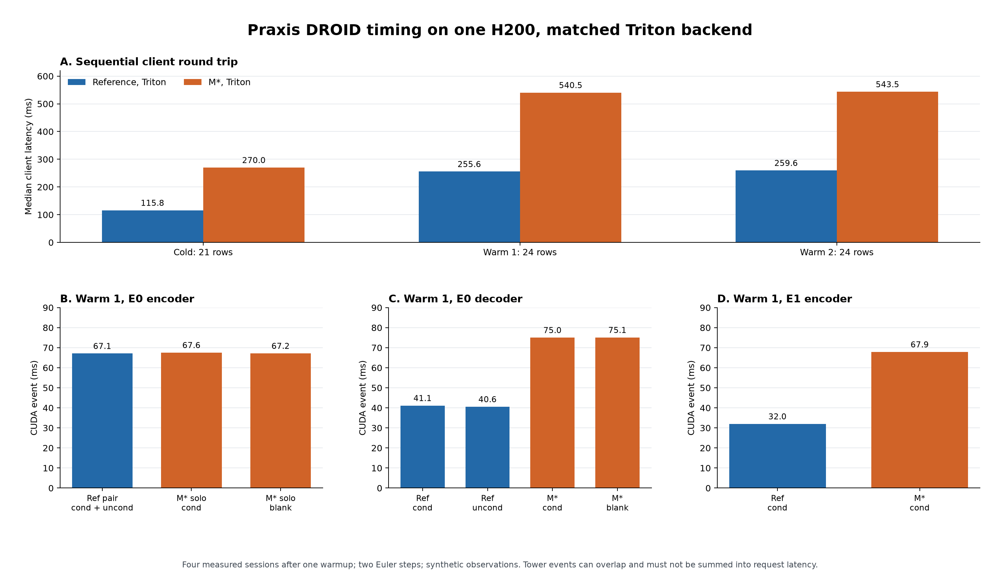

# Praxis DROID tower diagnostic on one H200

This chart compares the reference and M\* on one NVIDIA H200 with the DROID BF16 checkpoint, two Euler steps, and Triton attention in both implementations. It uses one warmup session and four measured sessions, each with a cold call followed by two warm calls. The shared input is a synthetic 46-frame DROID stream. Each bar is the median of four calls; this is sequential client latency, not concurrent throughput.

| Source | Pinned commit | PyTorch | Triton |
|---|---|---|---|
| Reference | `68f4d7a254b4bf41951d2e97f44b07f6cac2bf69` | `2.13.0+cu130` | `3.7.1` |
| M\* #1520 | `5902054c0f9fa057a80ae5a7e15e67f19d4bcde2` | `2.12.1+cu132` | `3.7.1` |

The reference ran with `compile=None`; M\* used `-O0` without graph capture. These are bring-up conditions. The two PyTorch/CUDA builds differ, so this chart identifies where the measured time differs without isolating a single kernel. The recorded command hashes were stable within each arm across 15 calls; outputs between arms were not equal.

The lower panels show CUDA-event medians for warm call 1. `E0` and `E1` are the first and final Euler steps. The reference E0 encoder event processes conditional and unconditional branches together. M\* processes its conditional and blank branches in separate events; blank corresponds to reference unconditional. Reference decoder and side-stream expert work may overlap. **Do not add tower events to estimate request latency.** The client bars are the end-to-end measurement.

The four warm-call-1 tower medians most relevant to the gap are: reference paired E0 encoder 67.1 ms versus M\* 67.6 ms conditional and 67.2 ms blank; reference E0 decoder 41.1/40.6 ms versus M\* 75.0/75.1 ms; and reference conditional E1 encoder 32.0 ms versus M\* 67.9 ms. The warm client median is 255.6 ms reference versus 540.5 ms M\*.

Files:

- `tower-diagnostic.png` and `.svg`: the figure.
- `plot.py`: regenerates the figure from the checked data in this directory with Matplotlib and NumPy.
- `client-latencies.json`: the four measured client round trips per call, extracted from each full client report. `input-sha256.json` records the hashes of those original full reports and copied tower files.
- `matched-client.py`: the exact client script used for both arms (SHA-256 `65370861d3545910e63275e5b2d4bb63fdb875c958157e83a6c1efdacf75a06c`), run with `--sessions 5 --warmup-sessions 1` and the arm's `--mode`, session URL and output path.
- `reference-triton-tower-summary.json` and `mstar-triton-tower-summary.json`: validated source/backend versions and tower medians.
- `reference-triton-tower.jsonl` and `mstar-triton-tower.jsonl`: raw event traces used to validate the summaries.

This was not a closed-loop simulator run. The prior warm simulation guard was 6/7 episodes for M\* and 7/7 for the reference on one seed. The serving gate remains closed pending parity and performance work.
