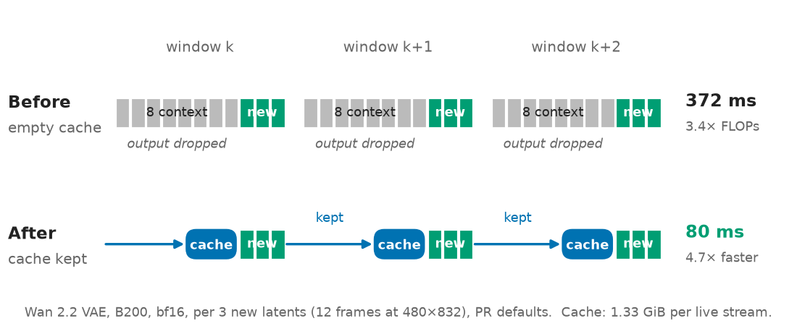
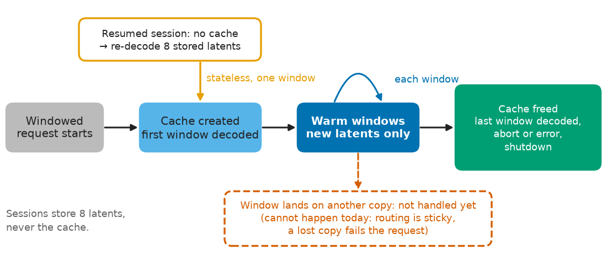

# Design

The streaming decoder (`Cosmos3VAEDecoderARSubmodule`) decodes each window statelessly at the decode level. It re-decodes the last 8 latents of context from an empty causal-conv cache, then drops the context pixels. This is the same left-context pattern M\* uses for other causal decoders (`LeftContextChunkPolicy` for the Qwen3-Omni vocoder). Nothing large stays on the GPU between windows, sessions stay simple, and `windowed_decode_context_latents` trades accuracy for work; each window runs 3.4× the useful conv work. This PR adds an optional warm path that sits next to the stateless decode, which remains the fallback.



*Before, each window decodes 8 context latents plus its new ones from an empty cache. After, it decodes only the new latents, continuing the cache the previous window left.*

**Warm path.** With `windowed_decode_warm_cache: true`, a stream's first window runs the same decode, but against a feature cache the node owns (`new_feat_cache` and `decode_causal` in `mstar/model/components/wan_vae.py`). The cache holds the last frames each causal conv saw. It lives in the request's state as `ar_feat_cache`, next to the context tail and window counter the node already keeps there. Each later window decodes only its new latents and updates the cache in place.

The output equals one decode of the whole stream: bit-identical eagerly in the default layout with the default `windowed_decode_latents_per_call: 1`, and within bf16 rounding with compile and channels-last. The cache is 1.33 GiB of tensors per live stream at 832×480 (Wan 2.2 VAE); under `torch.compile` a stream currently holds more (3.47 GiB) until the cache is compacted.



*A stream's cache lives exactly as long as its request on one decoder copy. A resumed session takes the stateless re-decode for one window; a stream that starts at the cap stays stateless.*

**Lifecycle.**
- **Created** on the stream's first window, if fewer than `windowed_decode_max_warm_streams` streams on this copy hold a cache (0: no cap). Decided once per stream.
- **Freed** when the last window is decoded. Otherwise it goes with the rest of the request state when the engine removes the request (`cleanup_request`), which covers abort, failure and normal teardown.
- **Sessions are unchanged.** The `SessionStore` keeps only the 8-latent tail, never the cache. A `resume_session` request's first window is the stateless re-decode behind the stored tail; later windows run warm.
- **Off switch.** `windowed_decode_warm_cache: false` restores the stateless decode for every window.

**Routing.** Before and after this PR, the conductor binds each request to one copy of every component at admission (`_assign_worker_graphs_to_workers`) and keeps that binding for the request's whole life, so every window of a stream reaches the same decoder copy. The node already keeps per-request state there (`ar_tail`, `ar_chunks`, `ar_pixels`); the cache is one more item in it. Upstream, losing a worker shuts the deployment down (`DeadWorkerError`); a stream's windows never move between copies.

**Placement.** Set by `node_groups`. The decoder node can share the DiT's GPU (as in `cosmos3_nano_ar.yaml` and `cosmos3_edge.yaml`) or run on its own GPU. The cache never leaves the decoder GPU, and what crosses GPUs per window doesn't change: window latents in (about 1–2 MB) and uint8 frames out (about 29 MB per 24 frames at 832×480). A decoder copy's memory grows with its live streams.

**Configuration.** `Cosmos3Config` fields, set under `model_kwargs` in the YAML like every other Cosmos3 switch; no new CLI flags:
- `windowed_decode_warm_cache` (default `true`)
- `windowed_decode_max_warm_streams` (`0`, no cap)
- `windowed_decode_latents_per_call` (`1`)
- `vae_decode_channels_last` (`true`, streaming decoder only)
- `vae_decode_cudnn_benchmark` (`false`, opt-in, streaming decoder only)

```yaml
model_kwargs:
  enable_windowed_video: true
  windowed_decode_warm_cache: false        # stateless decode for every window
  windowed_decode_max_warm_streams: 16     # at most 16 warm streams per decoder copy
```
